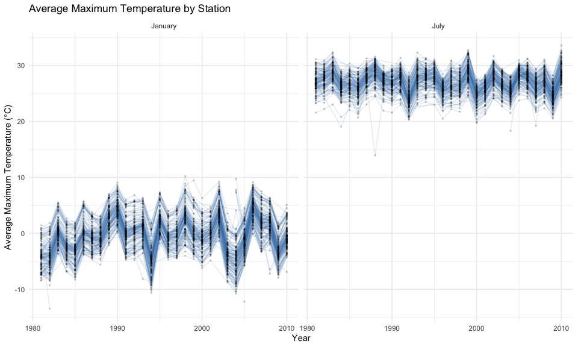
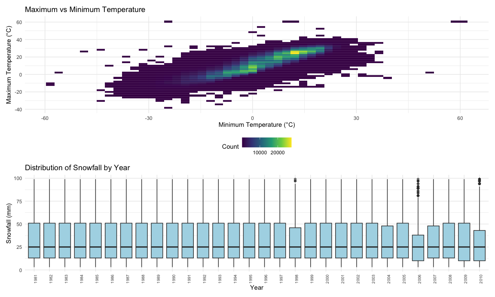
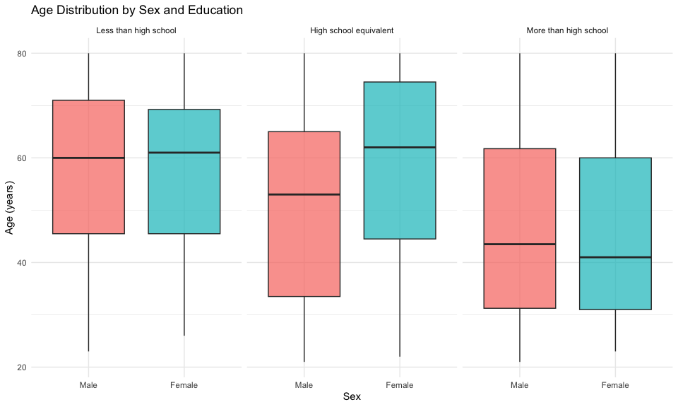
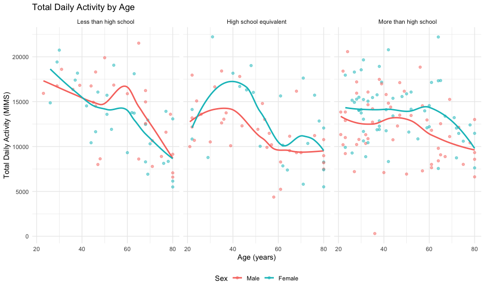
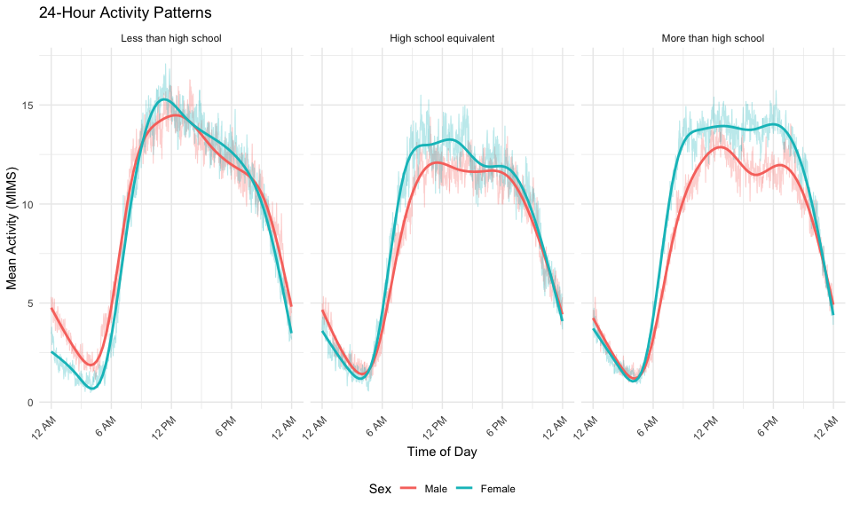
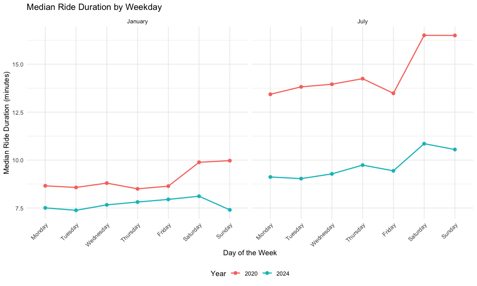
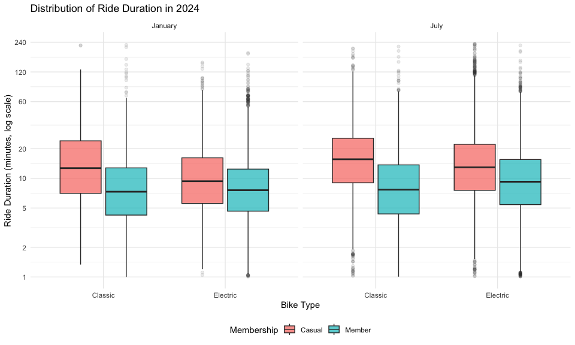

p8105_hw3_yr2560
================
Yiman Rui
2026-10-18

## Problem 1

### Description

``` r
library(p8105.datasets)
data("ny_noaa")
ny_noaa
```

    ## # A tibble: 2,595,176 × 7
    ##    id          date        prcp  snow  snwd tmax  tmin 
    ##    <chr>       <date>     <int> <int> <int> <chr> <chr>
    ##  1 US1NYAB0001 2007-11-01    NA    NA    NA <NA>  <NA> 
    ##  2 US1NYAB0001 2007-11-02    NA    NA    NA <NA>  <NA> 
    ##  3 US1NYAB0001 2007-11-03    NA    NA    NA <NA>  <NA> 
    ##  4 US1NYAB0001 2007-11-04    NA    NA    NA <NA>  <NA> 
    ##  5 US1NYAB0001 2007-11-05    NA    NA    NA <NA>  <NA> 
    ##  6 US1NYAB0001 2007-11-06    NA    NA    NA <NA>  <NA> 
    ##  7 US1NYAB0001 2007-11-07    NA    NA    NA <NA>  <NA> 
    ##  8 US1NYAB0001 2007-11-08    NA    NA    NA <NA>  <NA> 
    ##  9 US1NYAB0001 2007-11-09    NA    NA    NA <NA>  <NA> 
    ## 10 US1NYAB0001 2007-11-10    NA    NA    NA <NA>  <NA> 
    ## # ℹ 2,595,166 more rows

``` r
# Missing data
missing_sum =
  ny_noaa |>
  summarize(
    across(
      c(prcp, snow, snwd, tmax, tmin),
      ~sum(is.na(.x))
    )
  ) |>
  pivot_longer(
    cols = everything(),
    names_to = "variable",
    values_to = "n_missing"
  ) |>
  mutate(
    pct_missing = 100 * n_missing / nrow(ny_noaa)
  )

missing_sum |>
  knitr::kable(
    digits = 2,
    col.names = c(
      "Variable",
      "Missing Values",
      "Percent Missing"
    )
  )
```

| Variable | Missing Values | Percent Missing |
|:---------|---------------:|----------------:|
| prcp     |         145838 |            5.62 |
| snow     |         381221 |           14.69 |
| snwd     |         591786 |           22.80 |
| tmax     |        1134358 |           43.71 |
| tmin     |        1134420 |           43.71 |

The `ny_noaa` dataset contains 2595176 observations and 7 variables from
747 weather stations in New York State. Each row represents a daily
weather observation at a particular station.

The variables include station ID (`id`), observation date (`date`),
precipitation (`prcp`), snowfall (`snow`), snow depth (`snwd`), maximum
temperature (`tmax`), and minimum temperature (`tmin`).

Missing values are major issue in this dataset, particularly for maximum
and minimum temperatures, which both have approximately 43.71% missing
observations. Snow depth also has considerable missingness (22.80%),
while precipitation has the lowest percentage (5.62%). These missing
values may affect the representativeness of the temperature and snowfall
analyses, so they are excluded from the relevant calculations.

### Data Cleaning

``` r
ny_noaa_clean =
  ny_noaa |>
  mutate(
    year = lubridate::year(date),
    month = lubridate::month(date),
    day = lubridate::day(date),
    tmax = as.numeric(tmax) / 10,
    tmin = as.numeric(tmin) / 10,
    prcp = prcp / 10
  )

ny_noaa_clean
```

    ## # A tibble: 2,595,176 × 10
    ##    id          date        prcp  snow  snwd  tmax  tmin  year month   day
    ##    <chr>       <date>     <dbl> <int> <int> <dbl> <dbl> <dbl> <dbl> <int>
    ##  1 US1NYAB0001 2007-11-01    NA    NA    NA    NA    NA  2007    11     1
    ##  2 US1NYAB0001 2007-11-02    NA    NA    NA    NA    NA  2007    11     2
    ##  3 US1NYAB0001 2007-11-03    NA    NA    NA    NA    NA  2007    11     3
    ##  4 US1NYAB0001 2007-11-04    NA    NA    NA    NA    NA  2007    11     4
    ##  5 US1NYAB0001 2007-11-05    NA    NA    NA    NA    NA  2007    11     5
    ##  6 US1NYAB0001 2007-11-06    NA    NA    NA    NA    NA  2007    11     6
    ##  7 US1NYAB0001 2007-11-07    NA    NA    NA    NA    NA  2007    11     7
    ##  8 US1NYAB0001 2007-11-08    NA    NA    NA    NA    NA  2007    11     8
    ##  9 US1NYAB0001 2007-11-09    NA    NA    NA    NA    NA  2007    11     9
    ## 10 US1NYAB0001 2007-11-10    NA    NA    NA    NA    NA  2007    11    10
    ## # ℹ 2,595,166 more rows

### Commonly observed values

``` r
snow_df =
  ny_noaa_clean |>
  filter(!is.na(snow)) |>
  count(snow, sort = TRUE) |>
  slice_head(n = 10)

snow_df |>
  knitr::kable(
    col.names = c(
      "Snowfall (mm)",
      "Number of Observations"
    )
  )
```

| Snowfall (mm) | Number of Observations |
|--------------:|-----------------------:|
|             0 |                2008508 |
|            25 |                  31022 |
|            13 |                  23095 |
|            51 |                  18274 |
|            76 |                  10173 |
|             8 |                   9962 |
|             5 |                   9748 |
|            38 |                   9197 |
|             3 |                   8790 |
|           102 |                   6552 |

The most commonly observed snowfall value is 0 mm (2,008,508
observations), since most days have no measurable snowfall. Other common
values include 25, 13, 51, and 76 mm, which correspond approximately to
1, 0.5, 2, and 3 inches. This suggests that snowfall may have originally
been recorded in inches and converted to millimeters.

### Average max temperature in January and in July

``` r
jan_jul_df =
  ny_noaa_clean |>
  filter(month %in% c(1, 7)) |>
  group_by(id, year, month) |>
  summarize(
    mean_tmax = mean(tmax, na.rm = TRUE),
    n_obs = sum(!is.na(tmax)),
    .groups = "drop"
  ) |>
  filter(n_obs > 0) |>
  mutate(
    month = factor(
      month,
      levels = c(1, 7),
      labels = c("January", "July")
    )
  )

jan_jul_df |>
  ggplot(
    aes(x = year, y = mean_tmax, group = id)
  ) +
  geom_line(alpha = 0.15, color = "steelblue") +
  geom_point(alpha = 0.15, size = 0.5) +
  facet_grid(. ~ month) +
  labs(
    title = "Average Maximum Temperature by Station",
    x = "Year",
    y = "Average Maximum Temperature (°C)"
  )
```



``` r
jan_jul_df |>
  group_by(month) |>
  summarize(
    minimum = min(mean_tmax),
    maximum = max(mean_tmax),
    .groups = "drop"
  ) |>
  knitr::kable(digits = 2)
```

| month   | minimum | maximum |
|:--------|--------:|--------:|
| January |  -13.44 |   10.22 |
| July    |   13.95 |   33.60 |

The plot shows a clear seasonal difference, with average maximum
temperatures generally ranging from -10°C to 10°C in January and 20°C to
35°C in July. January temperatures fluctuate more noticeably across
years, while July temperatures remain relatively stable. There are also
some unusual observations, such as a particularly low July temperature
around 1988 and several extremely low January temperatures. Overall,
there is no clear long-term increasing or decreasing trend, although
temperature varies across stations and years.

### Two-panel plots

``` r
p_temp =
  ny_noaa_clean |>
  filter(!is.na(tmax), !is.na(tmin)) |>
  ggplot(aes(x = tmin, y = tmax)) +
  geom_bin2d(bins = 50) +
  scale_fill_viridis_c() +
  labs(
    title = "Maximum vs Minimum Temperature",
    x = "Minimum Temperature (°C)",
    y = "Maximum Temperature (°C)",
    fill = "Count"
  )

p_snow =
  ny_noaa_clean |>
  filter(snow > 0, snow < 100) |>
  ggplot(
    aes(x = factor(year), y = snow)
  ) +
  geom_boxplot(
    fill = "lightblue",
    outlier.alpha = 0.2
  ) +
  labs(
    title = "Distribution of Snowfall by Year",
    x = "Year",
    y = "Snowfall (mm)"
  ) +
  theme(
    axis.text.x = element_text(
      angle = 90,
      hjust = 1,
      size = 7
    )
  )

p_temp / p_snow
```



The histogram shows a strong positive relationship between minimum and
maximum daily temperatures. Most observations are concentrated along an
upward-sloping diagonal, indicating that higher minimum temperatures are
generally associated with higher maximum temperatures. A few isolated
observations show unusually high or low temperatures, potentially
indicating extreme values or data quality issues that may require
further investigation.

The snowfall distributions are relatively consistent across years, with
median snowfall remaining around 25 mm and similar interquartile ranges.
Most observations fall between approximately 13 and 51 mm, although
larger snowfall amounts occur occasionally. A few years, particularly
1998, 2006, and 2010, show some high outliers. Overall, the plot
suggests that the distribution of positive daily snowfall amounts below
100 mm remained fairly stable across the study period.

## Problem 2

``` r
nhanes_covar =
  read_csv(
    "Data/nhanes_covar.csv",
    skip = 4,
    show_col_types = FALSE
  ) |>
  janitor::clean_names()

nhanes_accel =
  read_csv(
    "Data/nhanes_accel.csv",
    show_col_types = FALSE
  ) |>
  janitor::clean_names()

# exclude participants less than 21 years of age & missing demographic data
nhanes_covar =
  nhanes_covar |>
  filter(age >= 21) |>
  drop_na() |>
  mutate(
    sex = factor(
      sex,
      levels = c(1, 2),
      labels = c("Male", "Female")
    ),
    education = factor(
      education,
      levels = c(1, 2, 3),
      labels = c(
        "Less than high school",
        "High school equivalent",
        "More than high school"
      )
    )
  ) |>
  drop_na()

nhanes_df =
  inner_join(
    nhanes_covar,
    nhanes_accel,
    by = "seqn"
  )

nhanes_df |>
  select(seqn, age, sex, education) |>
  head(6) |>
  knitr::kable()
```

|  seqn | age | sex    | education              |
|------:|----:|:-------|:-----------------------|
| 62161 |  22 | Male   | High school equivalent |
| 62164 |  44 | Female | More than high school  |
| 62169 |  21 | Male   | High school equivalent |
| 62174 |  80 | Male   | More than high school  |
| 62177 |  51 | Male   | High school equivalent |
| 62178 |  80 | Male   | High school equivalent |

The cleaned and merged dataset contains 228 participants and 1445
variables. Participants younger than 21 and those with missing
demographic information were removed. Sex and education were converted
to factors so that they could be presented with meaningful labels and
ordered consistently in tables and visualizations. All original
variables were retained in the merged dataset.

### Number of men and women by education levels

``` r
education_table =
  nhanes_df |>
  count(education, sex) |>
  pivot_wider(
    names_from = sex,
    values_from = n,
    values_fill = 0
  )

# readable table
education_table |>
  knitr::kable(
    caption = "Number of Participants by Sex and Education Level"
  )
```

| education              | Male | Female |
|:-----------------------|-----:|-------:|
| Less than high school  |   27 |     28 |
| High school equivalent |   35 |     23 |
| More than high school  |   56 |     59 |

Number of Participants by Sex and Education Level

``` r
# visualization for age distribution of men and women by education levels
nhanes_df |>
  ggplot(aes(x = sex, y = age, fill = sex)) +
  geom_boxplot(alpha = 0.7) +
  facet_wrap(~education, nrow = 1) +
  labs(
    title = "Age Distribution by Sex and Education",
    x = "Sex",
    y = "Age (years)",
    fill = "Sex"
  ) +
  theme(legend.position = "none")
```



After excluding participants younger than 21 and those with missing
demographic information, 228 participants remained. The group with more
than a high school education had the most participants (115), followed
by high school equivalent (58) and less than high school (55). Men and
women were relatively evenly distributed overall, although the high
school equivalent group had more men than women.

Participants with more than a high school education tended to be
younger, with median ages around 41–44 years, compared with
approximately 60–61 years for those with less than a high school
education. In the high school equivalent group, women had a higher
median age than men. Overall, age distributions varied more across
education levels than between sexes.

### Total daily activity

``` r
nhanes_df =
  nhanes_df |>
  mutate(
    total_activity = rowSums(
      across(starts_with("min")),
      na.rm = TRUE
      )
    )

nhanes_df |>
  select(seqn, age, sex, education, total_activity)
```

    ## # A tibble: 228 × 5
    ##     seqn   age sex    education              total_activity
    ##    <dbl> <dbl> <fct>  <fct>                           <dbl>
    ##  1 62161    22 Male   High school equivalent         13194.
    ##  2 62164    44 Female More than high school          13411.
    ##  3 62169    21 Male   High school equivalent          9991.
    ##  4 62174    80 Male   More than high school           8579.
    ##  5 62177    51 Male   High school equivalent         11918.
    ##  6 62178    80 Male   High school equivalent          7489.
    ##  7 62180    35 Male   More than high school          14205.
    ##  8 62184    26 Male   High school equivalent         13599.
    ##  9 62189    30 Female More than high school          18551.
    ## 10 62199    57 Male   More than high school          14548.
    ## # ℹ 218 more rows

``` r
# Plot age vs total_activity
nhanes_df |>
  ggplot(
    aes(
      x = age,
      y = total_activity,
      color = sex
    )
  ) +
  geom_point(alpha = 0.5) +
  geom_smooth(se = FALSE) +
  facet_wrap(~education, nrow = 1) +
  labs(
    title = "Total Daily Activity by Age",
    x = "Age (years)",
    y = "Total Daily Activity (MIMS)",
    color = "Sex"
  )
```



``` r
activity_age_summary =
  nhanes_df |>
  mutate(
    age_group = case_when(
      age < 40 ~ "21–39",
      age < 60 ~ "40–59",
      TRUE ~ "60+"
    )
  ) |>
  group_by(age_group) |>
  summarize(
    median_activity = median(total_activity, na.rm = TRUE),
    .groups = "drop"
  )

activity_age_summary |>
  knitr::kable(
    digits = 2,
    caption = "Median Daily Activity by Age Group"
  )
```

| age_group | median_activity |
|:----------|----------------:|
| 21–39     |        14046.28 |
| 40–59     |        14131.85 |
| 60+       |        10417.80 |

Median Daily Activity by Age Group

Total daily activity generally decreased with age, particularly among
participants older than 60. The trend was more noticeable in the lower
education groups, while participants with more than a high school
education showed relatively stable activity levels through middle age.
There was considerable individual variation, and differences between men
and women were not consistent across education groups.

Median daily activity was similar for participants aged 21–39 (14,046.28
MIMS) and 40–59 (14,131.85 MIMS), but decreased to 10,417.80 MIMS among
participants aged 60 or older. This suggests that older adults generally
had lower daily physical activity, while younger and middle-aged
participants had comparable activity levels.

### 24-hour activity time courses

``` r
nhanes_long =
  nhanes_df |>
  pivot_longer(
    cols = starts_with("min"),
    names_to = "minute",
    values_to = "mims"
  ) |>
  mutate(
    minute = as.numeric(
      str_remove(minute, "min")
    ) - 1
  )

# time summary
activity_time =
  nhanes_long |>
  group_by(education, sex, minute) |>
  summarize(
    mean_mims = mean(mims, na.rm = TRUE),
    .groups = "drop"
  )

activity_time
```

    ## # A tibble: 8,640 × 4
    ##    education             sex   minute mean_mims
    ##    <fct>                 <fct>  <dbl>     <dbl>
    ##  1 Less than high school Male       0      5.31
    ##  2 Less than high school Male       1      5.06
    ##  3 Less than high school Male       2      4.72
    ##  4 Less than high school Male       3      5.02
    ##  5 Less than high school Male       4      4.55
    ##  6 Less than high school Male       5      4.88
    ##  7 Less than high school Male       6      4.87
    ##  8 Less than high school Male       7      5.18
    ##  9 Less than high school Male       8      5.02
    ## 10 Less than high school Male       9      5.26
    ## # ℹ 8,630 more rows

``` r
# Plots
activity_time |>
  ggplot(
    aes(
      x = minute,
      y = mean_mims,
      color = sex
    )
  ) +
  geom_line(alpha = 0.3, linewidth = 0.4) +
  geom_smooth(
    se = FALSE,
    span = 0.08,
    linewidth = 1
  ) +
  facet_wrap(~education, nrow = 1) +
  scale_x_continuous(
    breaks = seq(0, 1440, by = 360),
    labels = c(
      "12 AM", "6 AM", "12 PM", 
      "6 PM", "12 AM"
    ),
    limits = c(0, 1440)
  ) +
  labs(
    title = "24-Hour Activity Patterns",
    x = "Time of Day",
    y = "Mean Activity (MIMS)",
    color = "Sex"
  ) +
  theme(
    axis.text.x = element_text(
      angle = 45,
      hjust = 1
    )
  )
```



Activity levels are lowest during the early morning (around 4 AM),
increase sharply after 6 AM, and remain relatively high throughout the
day before declining at night. Women generally show higher daytime
activity than men, particularly in the high school equivalent and more
than high school education groups. In the less than high school group,
activity patterns are more similar between sexes. Overall, all three
education groups show similar daily activity cycles, but the magnitude
and timing of activity peaks differ by sex and education level.

## Problem 3

Data import

``` r
jan_2020 =
  read_csv(
    "Data/Jan 2020 Citi.csv",
    show_col_types = FALSE
  ) |>
  mutate(
    year = 2020,
    month = "January"
  )

jul_2020 =
  read_csv(
    "Data/July 2020 Citi.csv",
    show_col_types = FALSE
  ) |>
  mutate(
    year = 2020,
    month = "July"
  )

jan_2024 =
  read_csv(
    "Data/Jan 2024 Citi.csv",
    show_col_types = FALSE
  ) |>
  mutate(
    year = 2024,
    month = "January"
  )

jul_2024 =
  read_csv(
    "Data/July 2024 Citi.csv",
    show_col_types = FALSE
  ) |>
  mutate(
    year = 2024,
    month = "July"
  )
```

Combine data

``` r
citibike =
  bind_rows(
    jan_2020,
    jul_2020,
    jan_2024,
    jul_2024
  ) |>
  mutate(
    month = factor(
      month,
      levels = c("January", "July")
    ),
    weekdays = factor(
      weekdays,
      levels = c(
        "Monday", "Tuesday", "Wednesday",
        "Thursday", "Friday", "Saturday", "Sunday"
      )
    ),
    member_casual = factor(
      member_casual,
      levels = c("casual", "member"),
      labels = c("Casual", "Member")
    ),
    rideable_type = factor(
      rideable_type,
      levels = c("classic_bike", "electric_bike"),
      labels = c("Classic", "Electric")
    )
  )

citibike
```

    ## # A tibble: 99,485 × 9
    ##    ride_id   rideable_type weekdays duration start_station_name end_station_name
    ##    <chr>     <fct>         <fct>       <dbl> <chr>              <chr>           
    ##  1 4BE06CB3… Classic       Tuesday     15.3  Columbus Ave & W … E 53 St & Madis…
    ##  2 26886E03… Classic       Wednesd…     5.31 2 Ave & E 96 St    1 Ave & E 110 St
    ##  3 24DC5606… Classic       Friday       9.69 Columbia St & Riv… Grand St & Eliz…
    ##  4 EEDC1053… Classic       Sunday       7.00 W 84 St & Columbu… Columbus Ave & …
    ##  5 2CD4BD4C… Classic       Friday       2.85 Forsyth St & Broo… Suffolk St & St…
    ##  6 E18682F9… Classic       Sunday      25.5  Allen St & Hester… Atlantic Ave & …
    ##  7 B9B2E896… Classic       Sunday       3.65 Lafayette St & Je… Washington Pl &…
    ##  8 DEF8F504… Classic       Sunday      38.3  28 Ave & 44 St     Broadway & Kosc…
    ##  9 17D44DA9… Classic       Thursday    38.5  Barrow St & Hudso… Emerson Pl & My…
    ## 10 0FD113A3… Classic       Tuesday      6.52 Carlton Ave & Par… Emerson Pl & My…
    ## # ℹ 99,475 more rows
    ## # ℹ 3 more variables: member_casual <fct>, year <dbl>, month <fct>

The combined dataset contains 99485 rides and 9 variables. Each row
represents one Citi Bike ride from the 1% sample of rides lasting less
than four hours.

The dataset includes ride ID, bike type, day of the week, ride duration
in minutes, starting and ending stations, membership status, year, and
month.

There are some missing station names, but the ride duration and
membership information are available for the observations used in the
following analyses. Missing starting station names are excluded only
when ranking the most popular starting stations.

### Number of rides by year, month, and membership

``` r
ride_table =
  citibike |>
  group_by(year, month, member_casual) |>
  summarize(
    n_rides = n(),
    .groups = "drop"
  ) |>
  pivot_wider(
    names_from = member_casual,
    values_from = n_rides
  ) |>
  arrange(year, month)

ride_table |>
  knitr::kable(
    caption = "Number of Citi Bike Rides by Year, Month, and Membership"
  )
```

| year | month   | Casual | Member |
|-----:|:--------|-------:|-------:|
| 2020 | January |    984 |  11436 |
| 2020 | July    |   5637 |  15411 |
| 2024 | January |   2108 |  16753 |
| 2024 | July    |  10894 |  36262 |

Number of Citi Bike Rides by Year, Month, and Membership

The number of sampled Citi Bike rides increased substantially from 2020
to 2024, with July consistently having more rides than January. Members
accounted for the majority of rides in all four months. July 2024 had
the highest number of sampled rides, with 36,262 member rides and 10,894
casual rides. These patterns suggest greater cycling activity during
warmer months and increased system usage over time.

### Five most popular starting stations in July 2024

``` r
top_stations =
  citibike |>
  filter(
    year == 2024,
    month == "July",
    !is.na(start_station_name)
  ) |>
  count(
    start_station_name,
    sort = TRUE
  ) |>
  slice_head(n = 5)

top_stations |>
  knitr::kable(
    col.names = c(
      "Starting Station",
      "Number of Rides"
    ),
    caption = "Five Most Popular Starting Stations in July 2024"
  )
```

| Starting Station         | Number of Rides |
|:-------------------------|----------------:|
| Pier 61 at Chelsea Piers |             163 |
| University Pl & E 14 St  |             155 |
| W 21 St & 6 Ave          |             152 |
| West St & Chambers St    |             150 |
| W 31 St & 7 Ave          |             146 |

Five Most Popular Starting Stations in July 2024

### Median ride duration by weekday, month, and year

``` r
median_duration_df =
  citibike |>
  group_by(year, month, weekdays) |>
  summarize(
    median_duration = median(duration),
    .groups = "drop"
  )

median_duration_df
```

    ## # A tibble: 28 × 4
    ##     year month   weekdays  median_duration
    ##    <dbl> <fct>   <fct>               <dbl>
    ##  1  2020 January Monday               8.66
    ##  2  2020 January Tuesday              8.57
    ##  3  2020 January Wednesday            8.80
    ##  4  2020 January Thursday             8.50
    ##  5  2020 January Friday               8.64
    ##  6  2020 January Saturday             9.88
    ##  7  2020 January Sunday               9.97
    ##  8  2020 July    Monday              13.4 
    ##  9  2020 July    Tuesday             13.8 
    ## 10  2020 July    Wednesday           14.0 
    ## # ℹ 18 more rows

``` r
median_duration_df |>
  ggplot(
    aes(
      x = weekdays,
      y = median_duration,
      color = factor(year),
      group = year
    )
  ) +
  geom_line(linewidth = 0.8) +
  geom_point(size = 2) +
  facet_grid(. ~ month) +
  labs(
    title = "Median Ride Duration by Weekday",
    x = "Day of the Week",
    y = "Median Ride Duration (minutes)",
    color = "Year"
  ) +
  theme(
    axis.text.x = element_text(
      angle = 45,
      hjust = 1
    )
  )
```



Median ride durations were generally longer in July than in January and
consistently shorter in 2024 than in 2020. Weekend rides tended to last
longer than weekday rides, especially in July 2020, when weekend medians
reached approximately 16.5 minutes. These patterns suggest that seasonal
conditions and differences between weekday commuting and weekend
recreational use may influence ride duration.

### Ride duration by membership and bike type in 2024

``` r
citibike |>
  filter(year == 2024) |>
  ggplot(
    aes(
      x = rideable_type,
      y = duration,
      fill = member_casual
    )
  ) +
  geom_boxplot(
    alpha = 0.7,
    outlier.alpha = 0.1
  ) +
  facet_grid(. ~ month) +
  scale_y_log10(
    breaks = c(1, 2, 5, 10, 20, 60, 120, 240)
  ) +
  labs(
    title = "Distribution of Ride Duration in 2024",
    x = "Bike Type",
    y = "Ride Duration (minutes, log scale)",
    fill = "Membership"
  )
```



``` r
duration_summary =
  citibike |>
  filter(year == 2024) |>
  group_by(
    month, member_casual, rideable_type
  ) |>
  summarize(
    median_duration = median(duration),
    .groups = "drop"
  )

duration_summary |>
  knitr::kable(
    digits = 2,
    caption = "Median Ride Duration by Month, Membership, and Bike Type"
  )
```

| month   | member_casual | rideable_type | median_duration |
|:--------|:--------------|:--------------|----------------:|
| January | Casual        | Classic       |           12.69 |
| January | Casual        | Electric      |            9.34 |
| January | Member        | Classic       |            7.32 |
| January | Member        | Electric      |            7.58 |
| July    | Casual        | Classic       |           15.62 |
| July    | Casual        | Electric      |           12.94 |
| July    | Member        | Classic       |            7.68 |
| July    | Member        | Electric      |            9.24 |

Median Ride Duration by Month, Membership, and Bike Type

Casual riders generally had longer ride durations than members across
both months and bike types. In July, casual riders had median durations
of 15.62 minutes on classic bikes and 12.94 minutes on electric bikes,
compared with 7.68 and 9.24 minutes for members. Ride durations were
generally longer in July than January, and casual riders showed greater
variability. Among members, electric bike rides tended to be slightly
longer than classic bike rides.
